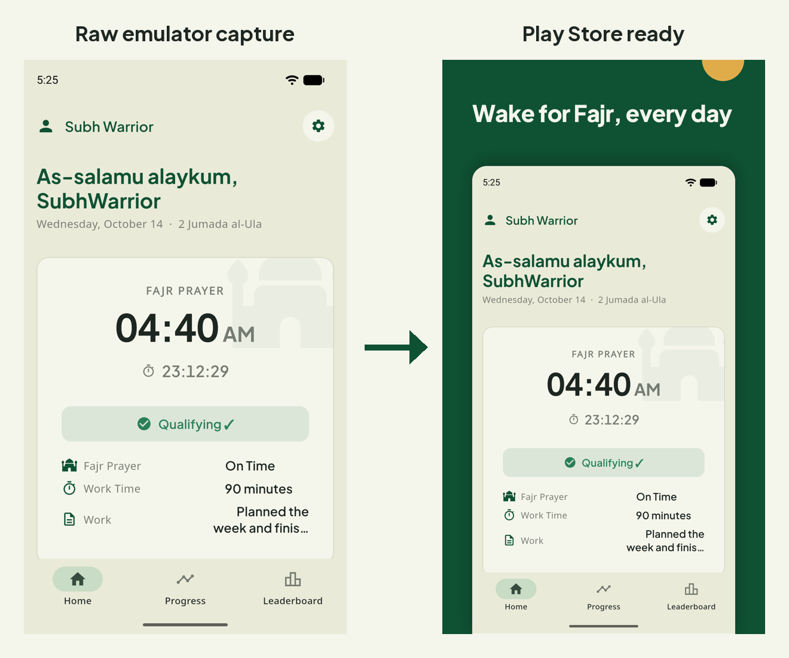
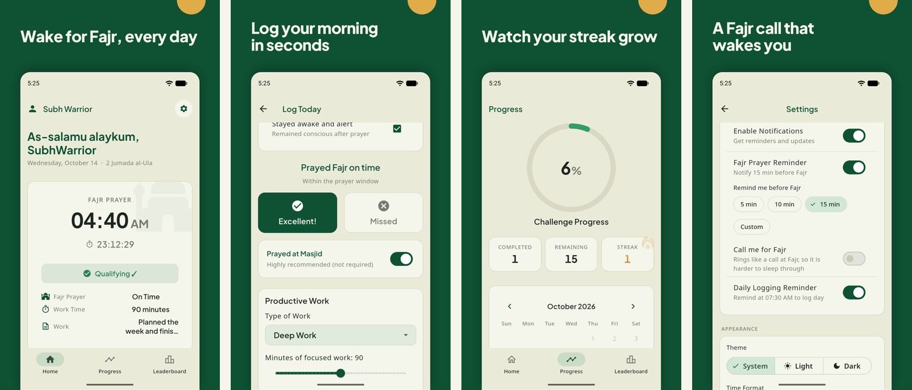

# playstore-screenshots

A [Claude Code](https://claude.com/claude-code) skill that turns your Android app into Google Play Store screenshots. Ask *"take Play Store screenshots of my app"* and Claude:

1. sets the emulator to 1080×1920 with a clean status bar (9:25, full wifi and battery, no notifications),
2. walks through your app and captures the screens worth showing,
3. writes a short caption for each one and draws it on your brand color,
4. restores the emulator and reports what it did and how many tokens it used.





Works with Flutter and native Android apps.

## Install

**As a plugin (recommended).** In Claude Code:

```
/plugin marketplace add Istiaq66/playstore-screenshots
/plugin install playstore-screenshots@playstore-screenshots
```

**As a plain skill.** Clone it into your skills folder:

```sh
git clone https://github.com/Istiaq66/playstore-screenshots ~/.claude/skills/playstore-screenshots
```

The clone works because the repo is also a plugin: Claude Code loads any plugin folder in `~/.claude/skills/`. Use one install or the other, not both, or the skill shows up twice.

Installed, the skill adds about 200 tokens to each session (its name and description). The full instructions load only when you ask for screenshots.

### Requirements

- Android SDK platform tools (`adb`) and a running emulator or a connected device, with your app installed
- Python 3 with Pillow: `python -m pip install pillow`
- A POSIX shell. On Windows, Claude Code's Bash tool (Git Bash) works.

## Use

From your app's repo:

> Take Play Store screenshots of the app

> Make store screenshots like the ones in ../other-app/store/screenshots

Before capturing, Claude asks which data the screenshots should show (the signed-in account as it is, a demo account, or a tidied account). It also leaves out screens that show an email or other personal details.

Output, in your repo:

```
store/screenshots/phone/            raw 1080x1920 captures
store/screenshots/phone-captioned/  upload these to Play Console (max 8)
```

The captioned images are RGB PNGs with no alpha channel, at Play's 9:16 phone size.

## Token cost

Each run ends with a table read from the Claude Code session log, subagents included:

```
model                calls     input  cache write   cache read    output    est. $
claude-opus-5-5         76       152      102,569    7,623,163    25,983     $2.87
total 7,751,867 tokens, est. $2.87 at API list prices (2026-09-25)
```

That is the first real run, 8 screenshots of a fitness app, done before this skill existed. Almost all of it is cache reads (each screenshot Claude looks at stays in context), which bill at a small fraction of the input price. On a Claude subscription nothing is charged per token, so the dollar figure is what the same run would cost on the API.

You can run the meter on its own:

```sh
python skills/playstore-screenshots/scripts/tokens.py start     # mark the start
python skills/playstore-screenshots/scripts/tokens.py report    # totals since the mark
python skills/playstore-screenshots/scripts/tokens.py report --all
```

Prices are in `tokens.py` (`PRICES`). Check them against [Anthropic's pricing page](https://claude.com/pricing) and update them when they change.

## What's inside

The skill lives in `skills/playstore-screenshots/`:

| File | What it does |
|---|---|
| `SKILL.md` | The workflow Claude follows |
| `scripts/device.sh` | `setup`: 1080×1920 screen and demo status bar. `restore`: undo both |
| `scripts/go.sh` | Runs taps, swipes and typing on the device, then captures the screen plus a small preview |
| `scripts/compose.py` | Draws the captioned screenshot from a JSON spec, and warns when a caption is too long |
| `scripts/sheet.py` | Puts several screenshots side by side for a quick review |
| `scripts/tokens.py` | Token and cost report for the run |
| `assets/` | Plus Jakarta Sans font (SIL Open Font License, `OFL.txt`) |

You can use `compose.py` on screenshots you already have:

```json
{"out": "store/screenshots/phone-captioned",
 "background": "#0F5233", "text": "#F4F5EB", "decor": "#E0AC4A",
 "shots": [{"name": "01-home", "file": "store/screenshots/phone/01-home.png",
            "caption": "Wake for Fajr, every day"}]}
```

```sh
python skills/playstore-screenshots/scripts/compose.py spec.json
```

## Credits

The layout follows [play-store-assets](https://github.com/Istiaq66/play-store-assets), a browser tool that makes the same captioned screenshots, plus the app icon and feature graphic, by hand. Sample screenshots are from Subh Warrior.

## License

MIT, see `LICENSE`. The bundled font keeps its own license (`skills/playstore-screenshots/assets/OFL.txt`).
